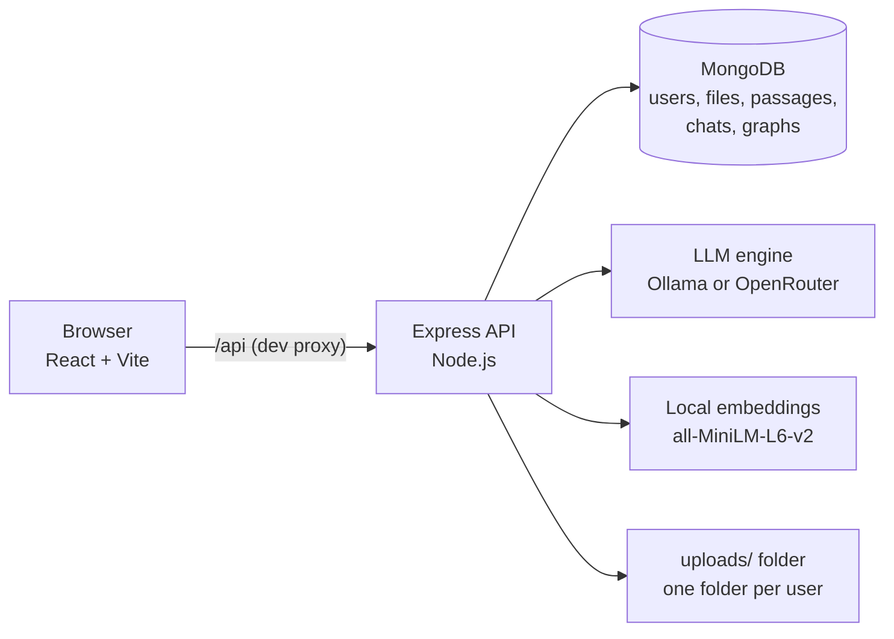
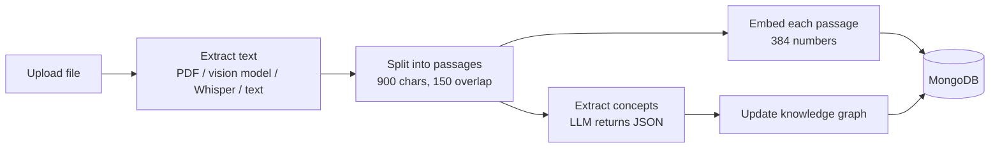
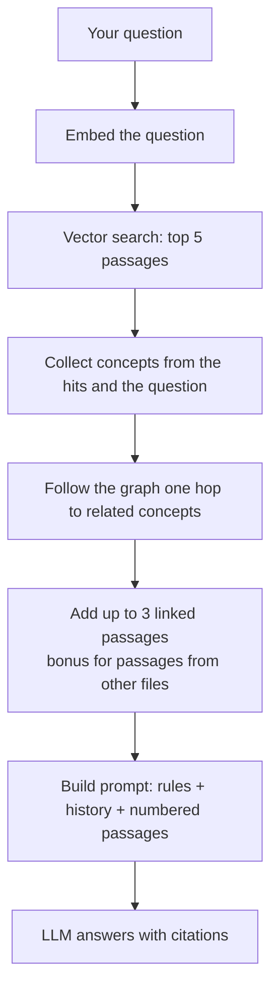

# NoteFusion AI

**Fragmented notes to connected knowledge.**

NoteFusion AI is a personal study assistant that turns handwritten notes, lecture audio, PDF slides and textbook pages into one searchable, **connected** library. You upload your material, ask questions in plain language, and get cited answers that pull together related passages from *different* files and formats, not just a summary of a single PDF.

It combines three techniques:

- **Prompt-based AI**: a carefully written system prompt keeps the model grounded in your notes.
- **RAG (Retrieval-Augmented Generation)**: your notes are split into passages, embedded, and the most relevant ones are retrieved for every question.
- **Knowledge graph**: an LLM extracts the concepts in each passage and links them across files, so one question can bring together a lecture, a handwritten diagram and a textbook page.

It runs **fully on your own computer** with [Ollama](https://ollama.com) (free, private, no rate limits), or with cloud models through [OpenRouter](https://openrouter.ai).

<!--
SCREENSHOTS: add your images to docs/screenshots/ and uncomment this block.

| Chat with cited answers | Knowledge graph | Library |
|---|---|---|
|  |  |  |
-->

---

## Table of contents

- [Features](#features)
- [How it works](#how-it-works)
- [Tech stack](#tech-stack)
- [Project structure](#project-structure)
- [Getting started](#getting-started)
- [Configuration](#configuration)
- [Using the app](#using-the-app)
- [API reference](#api-reference)
- [Security and privacy](#security-and-privacy)
- [Troubleshooting](#troubleshooting)
- [Limitations and roadmap](#limitations-and-roadmap)
- [License](#license)

---

## Features

- **Accounts and privacy**: sign up and log in. Every user has a completely separate library, knowledge graph and chat history.
- **Multimodal ingestion**: PDFs, photos of handwritten notes or whiteboards (read by a vision model), audio lectures (transcribed with Whisper), and `.txt` / `.md` files.
- **Cited answers**: every answer shows source chips and thumbnails of the matching photos. Passages found through the graph are marked **graph link**.
- **Knowledge graph page**: an interactive map of the concepts in your notes. Click a concept to see which files it appears in and what it connects to.
- **Library page**: drag and drop uploads, optional lecture date, passage and concept counts per file, delete files.
- **Chat history**: pinned, today, yesterday and earlier groups, with search, pin and delete.
- **Voice**: dictate questions with the microphone and have answers read aloud.
- **Local or cloud AI**: Ollama or OpenRouter, switchable with one setting. The model dropdown lists whatever you have installed.
- **Clear feedback**: uploads report how many passages and concepts were found, and explain why when a graph comes out empty.

## How it works

### Architecture



### Upload pipeline



### Question pipeline



### Hybrid retrieval in short

1. The question is embedded and compared with every passage using cosine similarity. The top 5 passages with a score of at least 0.15 are kept.
2. The concepts mentioned by those passages (and any known concept named in the question) become seeds in the graph.
3. The graph is followed one hop to related concepts, and passages that mention them become candidates.
4. Candidates are ranked by `similarity + 0.05 per shared concept + 0.15 bonus if the passage comes from a file not yet represented`. The bonus is what pulls in material from other files and formats.
5. The best 3 candidates are added, so the model sees up to 8 passages, each tagged as found by *vector* search or by *graph*.

## Tech stack

| Layer | Technology |
|---|---|
| Frontend | React (Vite), Tailwind CSS v4, lucide-react, react-force-graph-2d |
| Backend | Node.js, Express |
| Database | MongoDB with Mongoose |
| Auth | bcryptjs, JSON Web Tokens in an httpOnly cookie, express-rate-limit |
| AI engine | Ollama (local) or OpenRouter (cloud) |
| Embeddings | `@xenova/transformers` running `all-MiniLM-L6-v2` locally (384 dimensions) |
| File handling | multer, pdf-parse |
| Audio (optional) | Groq Whisper |

## Project structure

```
notefusion/
├── notefusion-backend/
│   ├── server.js                  # app setup, middleware order, route mounting
│   ├── package.json
│   ├── .env.example               # copy to .env
│   ├── scripts/
│   │   └── migrate-json-to-mongo.js   # only for upgrading from the old JSON-file version
│   └── src/
│       ├── config.js              # settings, AI provider choice, secrets
│       ├── db.js                  # MongoDB connection
│       ├── models/                # User, Doc, Chunk, Chat, Graph
│       ├── middleware/auth.js     # login cookie, requireAuth, requireRole
│       ├── routes/                # auth, chat, library (+ files), graph
│       └── services/
│           ├── llm.js             # Ollama + OpenRouter client, model list
│           ├── embeddings.js      # local MiniLM embeddings
│           ├── chunker.js         # splits text into passages
│           ├── ingest.js          # the upload pipeline
│           ├── concepts.js        # concept and relation extraction
│           ├── retrieval.js       # hybrid vector + graph search
│           ├── prompts.js         # system prompt and prompt builder
│           ├── vectorStore.js  libraryStore.js  chatStore.js  graphStore.js
│           └── userData.js        # bundles the stores for one user
└── notefusion-ui/
    ├── vite.config.js             # dev proxy to the backend
    └── src/
        ├── main.jsx  index.css
        ├── App.jsx                # login gate
        ├── Workspace.jsx          # main app state and handlers
        ├── api.js                 # every call to the backend
        └── components/            # AuthPage, Sidebar, Welcome, InputBar,
                                   # LibraryView, GraphView
```

## Getting started

### Prerequisites

- **Node.js 18 or newer** (developed on Node 22) and npm
- **MongoDB**, either:
  - [MongoDB Community Server](https://www.mongodb.com/try/download/community) installed and running locally, or
  - a free [MongoDB Atlas](https://www.mongodb.com/atlas) cluster (you only need its connection string)
- **Ollama** for local AI ([download](https://ollama.com/download)), *or* an [OpenRouter](https://openrouter.ai/keys) API key

### 1. Clone

```bash
git clone https://github.com/<your-username>/<your-repo>.git
cd <your-repo>
```

### 2. Get the AI models (Ollama)

```bash
ollama pull llama3.2            # answers and concept extraction (small and fast)
ollama pull llama3.2-vision     # reads photos of handwritten notes and diagrams
ollama list                     # shows the exact model names to use in .env
```

For noticeably better answers and knowledge graphs, use a 7 to 8 billion parameter model if you have about 8 GB of free RAM:

```bash
ollama pull qwen2.5:7b          # then set CHAT_MODEL and EXTRACT_MODEL to it in .env
```

> Using OpenRouter instead? Skip this step and see [Configuration](#configuration).

### 3. Start the backend

```bash
cd notefusion-backend
npm install
cp .env.example .env            # Windows: copy .env.example .env
```

Open `.env` and check at least these values (the defaults match a local MongoDB and Ollama):

```env
LLM_PROVIDER=ollama
CHAT_MODEL=llama3.2
EXTRACT_MODEL=llama3.2
VISION_MODEL=llama3.2-vision
MONGODB_URI=mongodb://127.0.0.1:27017/notefusion
```

Then run:

```bash
npm run dev
```

You should see `MongoDB connected` and `NoteFusion backend running on http://localhost:5000`. If a model from `.env` is not installed, the console tells you the exact `ollama pull` command to run.

The first upload downloads the small embedding model (about 25 MB). After that it works offline.

### 4. Start the frontend

In a second terminal:

```bash
cd notefusion-ui
npm install
npm run dev
```

Open **http://localhost:5173**, choose **Sign up**, and create your account.

> The frontend dev server proxies `/api` to `http://localhost:5000` (see `vite.config.js`). Restart it after changing that file.

## Configuration

All backend settings live in `notefusion-backend/.env`. See `.env.example` for comments.

| Variable | Default | Purpose |
|---|---|---|
| `PORT` | `5000` | Backend port |
| `LLM_PROVIDER` | `ollama` (or `openrouter` if a key is set) | Which AI engine writes answers |
| `OLLAMA_URL` | `http://127.0.0.1:11434` | Where Ollama listens |
| `CHAT_MODEL` | `llama3.2` | Model for answers |
| `EXTRACT_MODEL` | same as `CHAT_MODEL` | Model for concept extraction |
| `VISION_MODEL` | `llama3.2-vision` | Model that reads photos (must support images) |
| `OLLAMA_NUM_CTX` | `8192` | Context window in tokens |
| `OLLAMA_KEEP_ALIVE` | `10m` | How long Ollama keeps the model loaded |
| `OPENROUTER_API_KEY` | none | Needed only for OpenRouter |
| `GROQ_API_KEY` | none | Needed only to transcribe audio files |
| `MONGODB_URI` | `mongodb://127.0.0.1:27017/notefusion` | Database connection |
| `JWT_SECRET` | auto-generated | Signs login tokens |
| `CLIENT_ORIGIN` | `http://localhost:5173` | Allowed frontend origin (CORS) |
| `NODE_ENV` | `development` | Set to `production` behind HTTPS (makes the login cookie `Secure`) |

**Using OpenRouter instead of Ollama:**

```env
LLM_PROVIDER=openrouter
OPENROUTER_API_KEY=sk-or-...
CHAT_MODEL=openrouter/free
EXTRACT_MODEL=openrouter/free
VISION_MODEL=openrouter/free
```

Free OpenRouter models change often and have request limits, so the backend retries and falls back to the free router model automatically.

## Using the app

1. **Sign up** and log in.
2. Open **Library** and upload a few files on one topic, for example a lecture PDF, a photo of your handwritten notes and a textbook page. A banner shows how many passages and concepts were found in each.
3. Open **Knowledge Graph** to see the concepts and how they connect. Click a concept to see which files it appears in.
4. Go to **Chat** and ask a question, for example *"What did my notes say about scheduling, and which textbook page covers it?"*
5. Look at the **source chips** under the answer. Chips marked *(graph link)* were found through a related concept, not by similar wording alone.
6. Try the **microphone** to dictate a question and **Listen** to hear an answer.

## API reference

All routes except health and auth require a logged-in user (the `nf_token` cookie).

| Method and route | Description |
|---|---|
| `GET /api/health` | Status: database, AI provider, whether the engine is ready |
| `POST /api/auth/register` | Create an account and log in |
| `POST /api/auth/login` | Log in |
| `POST /api/auth/logout` | Log out |
| `GET /api/auth/me` | The current user |
| `POST /api/upload` | Upload up to 10 files (field `files`, optional `lectureDate`) |
| `GET /api/library` | List your files |
| `GET /api/files/:docId` | Open one of your files (ownership checked) |
| `DELETE /api/library/:id` | Remove a file with its passages and graph links |
| `POST /api/chat` | Ask a question: `{ chatId?, message, model? }` |
| `GET /api/models` | Models for the dropdown |
| `GET /api/chats` | Chat history |
| `GET /api/chats/:id` | One chat with messages and sources |
| `PATCH /api/chats/:id` | Rename or pin: `{ title?, pinned? }` |
| `DELETE /api/chats/:id` | Delete a chat |
| `GET /api/graph` | Nodes and links for the graph page |

## Security and privacy

- **Passwords** are hashed with bcrypt (cost 10) and are 8 to 72 characters. Login and signup are rate limited.
- **Sessions** are signed tokens in an `httpOnly`, `sameSite=lax` cookie (valid for 7 days). Page scripts cannot read the cookie. The user is looked up in MongoDB on every request, so deleting an account ends access at once.
- **Authorization**: the user id comes only from the verified token, never from the request body or URL. Every database query is filtered by it, so one user cannot read, change or delete another user's chats, files, passages or graph. Someone else's id returns the same 404 as one that does not exist.
- **Files** are never served by path. `GET /api/files/:docId` checks ownership in the database first, and sends `nosniff` and `Content-Security-Policy: sandbox` headers so an uploaded file can never run scripts.
- **Injection**: request values are converted to strings and ids are validated before they reach a query (prevents NoSQL operator injection).
- **Your data stays on your machine** when you use Ollama with the built-in local embeddings. Optional cloud parts: OpenRouter (if selected), Groq Whisper (audio), and the browser's own voice dictation (Chrome sends audio to Google).

**Before you push or deploy:**

- Never commit `.env`, `data/` or `uploads/` (the included `.gitignore` already excludes them).
- Set your own `JWT_SECRET` in production and `NODE_ENV=production` behind HTTPS.
- If a key was ever committed by mistake, rotate it.

## Troubleshooting

| Symptom | Likely cause and fix |
|---|---|
| Login page shows an error or "Not found" | Backend not running, or the Vite dev server was not restarted after editing `vite.config.js`. |
| Backend exits with "Could not connect to MongoDB" | Start MongoDB, or set a correct `MONGODB_URI` (Atlas needs your IP allowed). |
| "Cannot reach Ollama" | Open the Ollama app or run `ollama serve`. |
| "model ... not found" | Run the `ollama pull` command shown in the backend console, or set the model in `.env` to one from `ollama list`. |
| Upload says **0 concepts** | The extraction model returned unusable output. The banner shows what it said. Try a larger `EXTRACT_MODEL`, then delete and re-upload the file. |
| Poor or wrong answers | The model is too small. Use a 7 to 8 billion parameter model and check the source chips to see what the model was given. |
| Photo upload fails | `VISION_MODEL` must be a model that supports images, for example `llama3.2-vision`. |
| Audio upload fails | Set `GROQ_API_KEY` (free at console.groq.com), or upload a transcript as `.txt`. |
| Scanned PDF has no text | `pdf-parse` reads text only. Upload the pages as photos so the vision model reads them. |
| `ECONNRESET` in the Vite terminal | The backend restarted or crashed. Check the backend terminal for the real error. |
| Microphone does nothing | Use Chrome, Edge or Safari and allow microphone access (Firefox has no speech recognition). |

## Limitations and roadmap

**Known limitations**

- Vector search scores one user's passages in Node. This is fast for a personal library (thousands of passages) but not for millions.
- Each user's graph is one MongoDB document cached in the backend process, so the app assumes a single backend instance.
- Answer quality depends on the model. Small local models can misread notes and build thin graphs.
- Scanned PDFs are not OCR'd. Upload pages as photos instead.
- No email verification, password reset or social login yet.
- Answers are returned when complete, not streamed token by token.

**Ideas for next versions**

- MongoDB Atlas Vector Search or a dedicated vector database for large libraries
- Neo4j for the graph, with real graph queries
- Streaming answers
- A reranking step after retrieval
- Quiz and flashcard generation from a concept or lecture
- A "rebuild graph" button per file
- Highlighting the exact quoted sentence inside the original file
- Email verification, password reset and Google login

## License

Add a `LICENSE` file before sharing widely. [MIT](https://choosealicense.com/licenses/mit/) is a common choice for portfolio projects.

---

Built by **Your Name** ([GitHub](https://github.com/your-username)). If you find this project useful, a star helps others discover it.